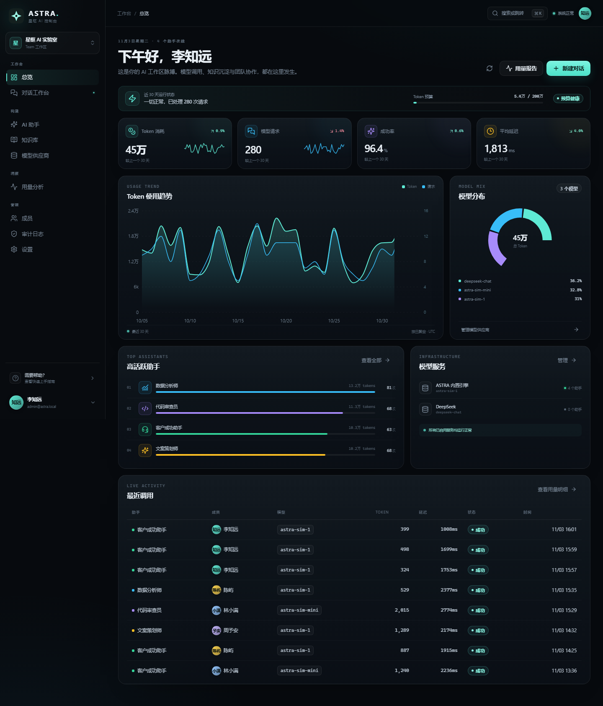
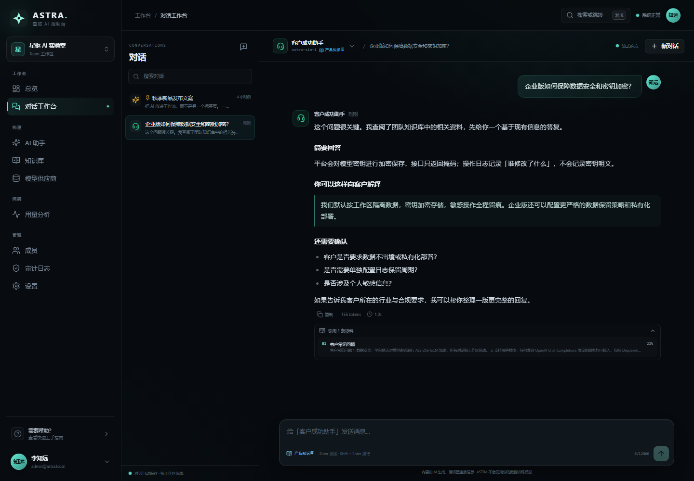
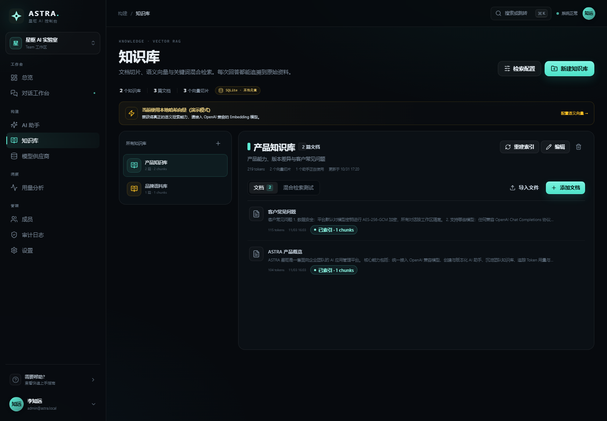
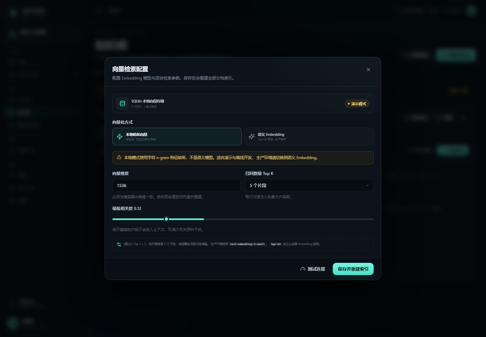
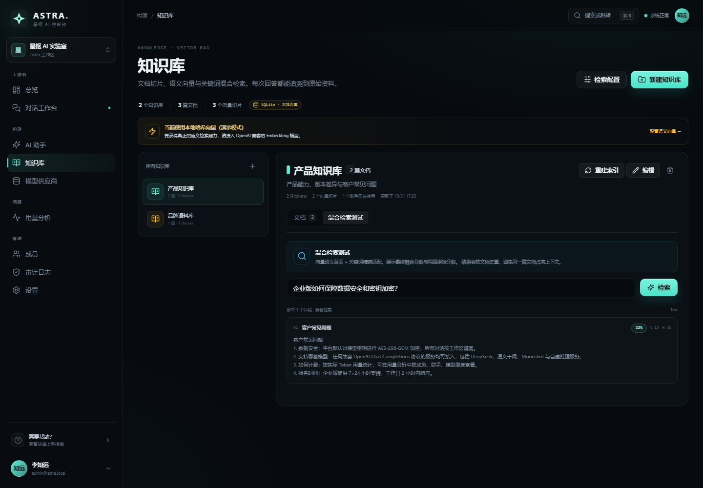
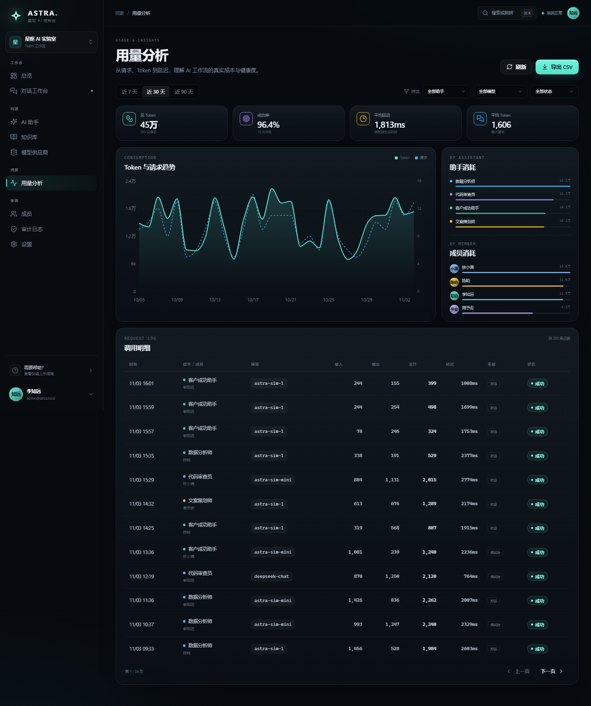
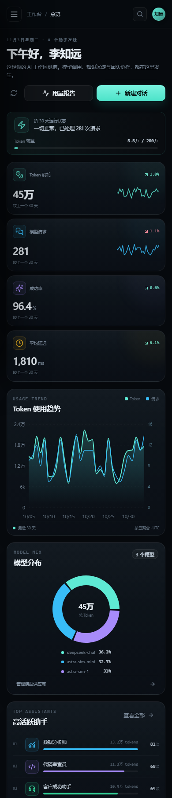

# 星枢 ASTRA · AI 管理控制台

一套可直接运行的企业级 AI 管理平台，覆盖 **模型接入 → 助手配置 → 知识库 → 对话工作台 → 用量分析 → 成员权限 → 审计** 的完整闭环。

内置模拟推理引擎，**没有 API Key 也能完整体验**；填入任意 OpenAI 兼容服务的密钥后即可切换真实模型。知识库内置 **向量 RAG**：文档切片、异步向量化、pgvector / 本地向量存储、混合检索与引用溯源。



| 对话工作台 · 引用溯源 | 知识库 · 向量 RAG |
| --- | --- |
|  |  |

| 向量检索配置 | 混合检索测试 |
| --- | --- |
|  |  |

| 用量分析 | 移动端 |
| --- | --- |
|  |  |

## 功能

| 模块 | 能力 |
| --- | --- |
| 总览仪表盘 | Token / 请求 / 成功率 / 延迟趋势、预算进度、模型分布、高活跃助手、服务健康、实时调用 |
| 对话工作台 | SSE 流式输出、多助手切换、Markdown 渲染、对话置顶 / 删除、Token 与延迟统计、停止生成 |
| AI 助手 | 角色提示词、模型与温度、最大输出、图标主题、知识库绑定、草稿 / 发布、复制、权限控制 |
| 知识库 | 多知识库、Markdown 标题感知切片、异步向量索引、语义 + 关键词混合检索、引用溯源、重建索引、检索测试 |
| 模型供应商 | OpenAI 兼容接入、API Key AES-256-GCM 加密、掩码展示、连接测试、模型列表 |
| 用量分析 | 7 / 30 / 90 天筛选、按助手 / 模型 / 成员拆分、调用明细、CSV 导出 |
| 成员与权限 | OWNER / ADMIN / MEMBER 三级角色、邀请成员、启停账号、最后负责人保护 |
| 审计日志 | 登录、配置、成员、知识、对话等关键操作留痕，不记录密钥明文 |
| 设置 | 工作区名称、Token 预算、时区、保留周期、默认助手、个人资料、修改密码 |

## 技术栈

- **前端**：React 19 + TypeScript + Vite 6 + Recharts + React Markdown + TanStack Query
- **后端**：Node.js + Express 4 + Zod + JWT + bcryptjs
- **业务数据库**：Node.js 内置 `node:sqlite`（WAL 模式，零原生依赖）
- **向量数据库**：PostgreSQL + pgvector（生产），SQLite 向量表（本地演示）
- **RAG**：OpenAI 兼容 Embedding / 本地特征哈希、异步索引队列、hybrid search、引用溯源
- **流式协议**：Server-Sent Events（SSE）
- **测试**：Vitest + Supertest
- **部署**：单进程生产模式 / Docker / Docker Compose（含 pgvector）

更详细的模块边界、数据模型、流式链路与安全设计见 [docs/ARCHITECTURE.md](docs/ARCHITECTURE.md)，向量 RAG 的索引、检索、调优与故障处理见 [docs/RAG.md](docs/RAG.md)。

## 快速开始

要求 **Node.js ≥ 24**（项目使用内置 `node:sqlite`，无需原生编译依赖），npm ≥ 10。

```bash
cd astra-ai-console
npm install
npm run dev
```

打开 **http://127.0.0.1:5173**。

| 角色 | 邮箱 | 密码 |
| --- | --- | --- |
| 负责人 | `admin@astra.local` | `Astra@2026` |
| 管理员 | `lin@astra.local` | `Astra@2026` |
| 成员 | `chen@astra.local` | `Astra@2026` |

> 首次启动会自动创建 SQLite 数据库、演示助手、知识库、90 天调用数据与审计记录。文档会在后台自动切片并建立本地向量索引，数据位于 `data/astra.db`。

### 使用真实模型

1. 进入「模型供应商」→「接入供应商」。
2. 选择 **OpenAI 兼容**，填写 Base URL、API Key 与模型名，例如：
   - DeepSeek：`https://api.deepseek.com/v1`，模型 `deepseek-chat`
   - OpenAI：`https://api.openai.com/v1`，模型 `gpt-4o-mini`
   - 自建 vLLM / Ollama 网关：填写对应地址。
3. 点击「测试连接」。
4. 到「AI 助手」中把助手的供应商和模型切换到新接入的服务。

密钥会在服务端加密后写入数据库，浏览器只会收到掩码。

### 启用语义向量 RAG

默认使用 **本地特征哈希向量**，零配置即可体验完整的索引、混合检索和引用链路，但它不是语义模型。

生产使用请：

1. 在「模型供应商」中接入一个支持 `/embeddings` 的 OpenAI 兼容服务。
2. 进入「知识库」→「检索配置」。
3. 选择 **语义 Embedding**，填写 provider 与模型，例如 `text-embedding-3-small`、`bge-m3`。
4. 填写向量维度（必须与模型输出一致），点击「测试连接」。
5. 保存后系统会清空旧向量并自动重建全部文档索引。

推荐配置：

| 场景 | 模型 | 维度 |
| --- | --- | --- |
| 通用中文 / 多语言 | `text-embedding-3-small` | 1536 |
| 高质量中文 | `bge-m3` | 1024 |
| 私有化 / 自建 | TEI / vLLM / Xinference 暴露的 Embedding 模型 | 按模型设置 |

不配置 `VECTOR_DATABASE_URL` 时向量存于 SQLite；生产建议使用 PostgreSQL + pgvector（Docker Compose 已内置）。

## 生产运行

```bash
cp .env.example .env
# 修改 JWT_SECRET 与 APP_SECRET
npm run build
npm start
```

访问 **http://127.0.0.1:8787**。生产模式下 Express 会直接托管 `apps/web/dist`。

### 环境变量

| 变量 | 默认值 | 说明 |
| --- | --- | --- |
| `PORT` | `8787` | API / Web 端口 |
| `JWT_SECRET` | 开发用占位值 | JWT 签名密钥，**生产必须修改** |
| `APP_SECRET` | 开发用占位值 | 供应商密钥加密派生密钥，**生产必须修改** |
| `JWT_EXPIRES_IN` | `7d` | 登录有效期 |
| `ASTRA_DATA_DIR` | `./data` | SQLite 数据目录 |
| `VECTOR_DATABASE_URL` | 空 | PostgreSQL + pgvector 连接串；为空时使用 SQLite 向量表 |
| `CORS_ORIGINS` | 空（反射） | 允许的前端来源，逗号分隔 |

### Docker

```bash
docker compose up -d --build
```

Compose 会同时启动：

- `astra`：应用，端口 8787
- `vector-db`：`pgvector/pgvector:pg17`，提供生产向量存储

数据分别保存在 `astra-data` 与 `astra-vectors` volume。首次启动会生成演示数据并自动建立索引。应用仍使用 SQLite 作为业务元数据存储；多实例部署时请将业务库一并迁移到 PostgreSQL。

## 常用命令

```bash
npm run dev          # 同时启动 API:8787 与 Vite:5173
npm run dev:server   # 仅后端
npm run dev:web      # 仅前端
npm run build        # 构建前端与后端
npm start            # 生产启动（需先 build）
npm test             # 后端集成测试
npm run typecheck    # 前后端 TypeScript 检查
npm run db:reset     # 重置数据库并恢复演示数据
```

## 项目结构

```text
astra-ai-console/
├─ apps/
│  ├─ server/
│  │  └─ src/
│  │     ├─ db/           # SQLite、schema、增量 migration、演示数据
│  │     ├─ lib/          # AI 流式调用、Embedding、切片、索引队列、RAG
│  │     ├─ vector/       # VectorStore 抽象、SQLite / pgvector 实现
│  │     ├─ routes/       # auth / dashboard / providers / assistants ...
│  │     ├─ app.ts        # Express 应用与静态托管
│  │     └─ index.ts      # 服务入口
│  └─ web/
│     └─ src/
│        ├─ components/   # AppShell、UI、Modal、Toast、Confirm
│        ├─ context/      # 登录状态
│        ├─ lib/          # API / SSE / 格式化 / 图标
│        ├─ pages/        # 9 个业务页面
│        └─ index.css     # 设计系统与响应式
├─ data/                  # 运行时生成，不提交
├─ docs/screenshots/
├─ Dockerfile
└─ docker-compose.yml
```

## API 概览

所有业务接口以 `/api` 为前缀，除 `/api/health` 与 `/api/auth/login` 外都需要 `Authorization: Bearer <token>`。

| 方法 | 路径 | 说明 |
| --- | --- | --- |
| POST | `/api/auth/login` | 登录 |
| GET | `/api/auth/me` | 当前用户 |
| GET | `/api/dashboard` | 仪表盘聚合数据 |
| GET/POST | `/api/providers` | 供应商列表 / 接入 |
| PATCH/DELETE | `/api/providers/:id` | 更新 / 删除 |
| POST | `/api/providers/:id/test` | 测试连接 |
| GET/POST | `/api/assistants` | 助手列表 / 创建 |
| PATCH/DELETE | `/api/assistants/:id` | 更新 / 删除 |
| POST | `/api/assistants/:id/duplicate` | 复制为草稿 |
| GET/POST | `/api/knowledge-bases` | 知识库 |
| POST | `/api/knowledge-bases/:id/documents` | 添加文档并触发异步索引 |
| POST | `/api/knowledge-bases/:id/reindex` | 重建知识库索引 |
| GET | `/api/knowledge-bases/:id/search?q=` | 混合检索测试 |
| GET | `/api/embeddings/config` | 当前 Embedding / 向量库配置 |
| PATCH | `/api/embeddings/config` | 更新配置并重建全部索引 |
| POST | `/api/embeddings/test` | 测试 Embedding 服务 |
| GET/POST | `/api/conversations` | 对话列表 / 创建 |
| POST | `/api/conversations/:id/messages` | **SSE 流式对话 + RAG 引用** |
| GET | `/api/usage` | 用量、趋势与分页明细 |
| GET/POST | `/api/users` | 成员列表 / 邀请 |
| GET/PATCH | `/api/settings` | 工作区设置 |
| GET | `/api/audit` | 审计日志 |

流式对话返回事件：`meta`（用户消息与标题）、`token`（增量文本）、`done`（完整消息、引用与用量）、`error`（错误与可选的部分内容）。

## 设计要点

- **统一 AI 网关**：供应商抽象为 `mock | openai`，只依赖 OpenAI Chat Completions 协议；流式转发时同步统计 Token 与延迟。
- **密钥安全**：AES-256-GCM + 随机 IV，`APP_SECRET` 经 SHA-256 派生；API 永不返回明文密钥。
- **向量 RAG**：Markdown 标题感知切片（约 900 字 + 140 字 overlap）→ 异步 Embedding → 向量存储 → 向量与关键词混合打分 → 文档去重 → Top K 注入 → 引用回传。
- **双向量后端**：`VECTOR_DATABASE_URL` 存在时使用 pgvector + HNSW + pg_trgm；否则使用 SQLite 向量表 + JS cosine，保证本地零依赖可运行。
- **可观测与可恢复**：索引任务持久化到 `index_jobs`，失败原因写入文档；检索写入 `retrieval_logs`；支持单文档、知识库和全量重建。
- **流式体验**：SSE + 原生 `fetch` ReadableStream 解析，客户端可中断；服务端保存已生成部分并记录失败调用。
- **演示数据**：固定种子生成 90 天调用记录、4 个助手、2 个知识库、3 个示例对话，首屏即有完整可视化。
- **权限边界**：后端强制校验角色与对话归属；前端隐藏成员不可用的管理入口；禁止停用自己、禁止移除最后一位负责人。

## 测试

```bash
npm test
```

覆盖登录、权限、仪表盘、助手创建、SSE 流式对话、知识库异步索引、混合检索、RAG 引用、配置权限、切片 / 向量 / 词法单元测试等 13 个场景。

## 生产上线前建议

当前项目定位为 **可完整运行的单体管理平台**。RAG 层已具备生产路径（pgvector、异步索引、混合检索、引用、可重建），但整体投入公网前仍建议补充：

1. 使用 HTTPS，并将 JWT 改为 `HttpOnly + Secure + SameSite` Cookie（配合 CSRF 防护）。
2. 将业务元数据从 SQLite 迁移到 PostgreSQL，并接入正式 migration 工具；当前只提供轻量增量迁移。
3. 接入 Redis 做分布式登录限流、会话撤销与跨实例索引任务锁。
4. 增加 PDF / DOCX 解析、对象存储、文档级权限与增量索引。
5. 接入 OpenTelemetry、结构化日志、检索质量评估（Recall@K / Faithfulness）与错误告警。
6. 多租户隔离（当前是单工作区模型）与 SSO / SCIM。
7. 为 Embedding / 对话服务配置超时、重试、熔断与成本预算控制。

## License

MIT。演示数据、品牌与文案仅用于项目展示。
